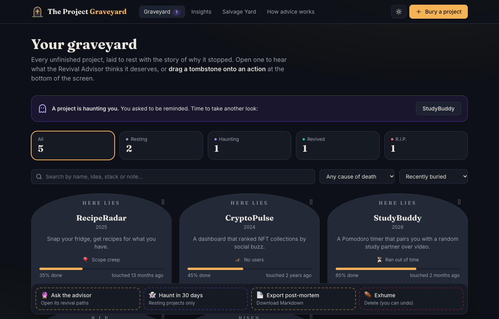
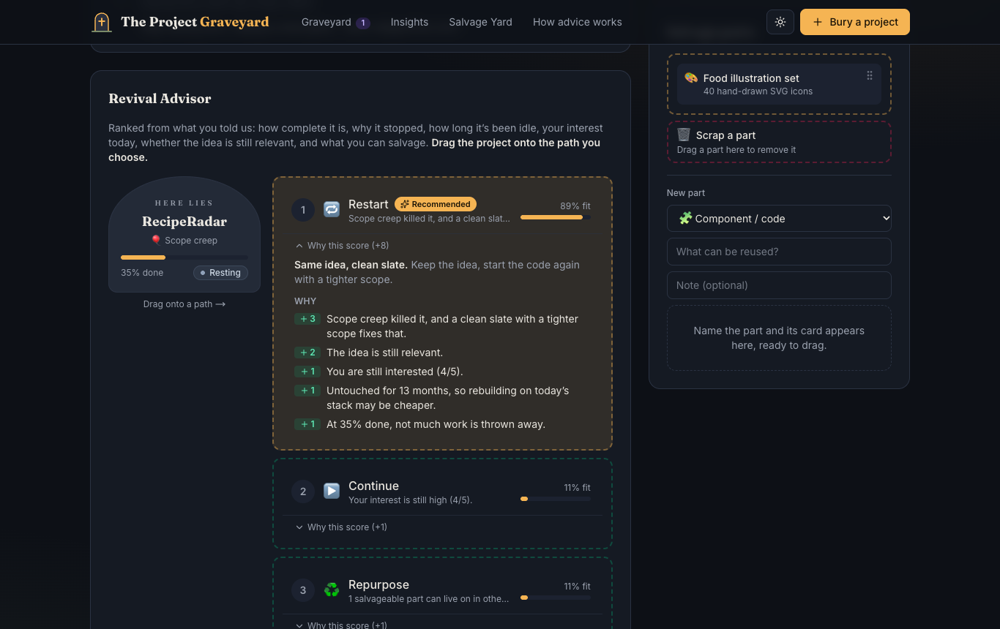
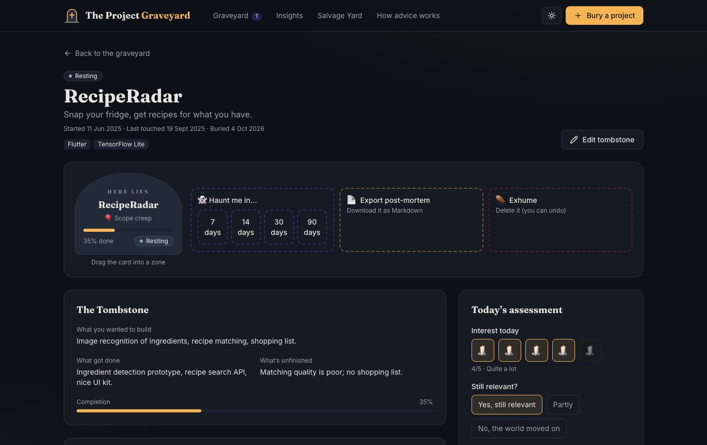
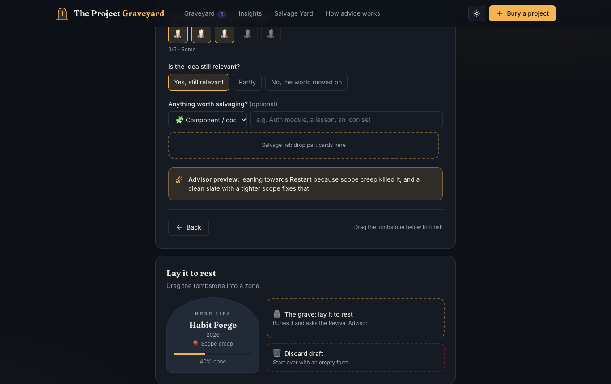
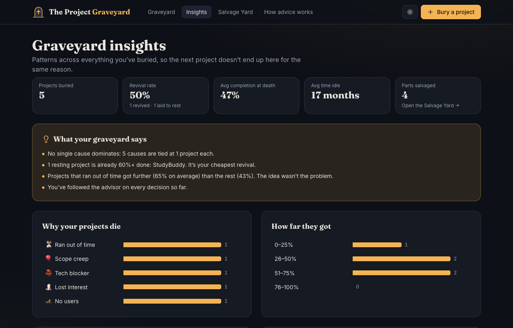
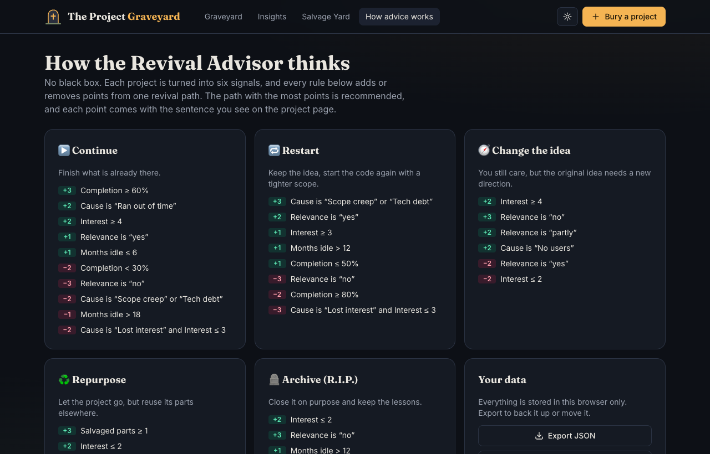
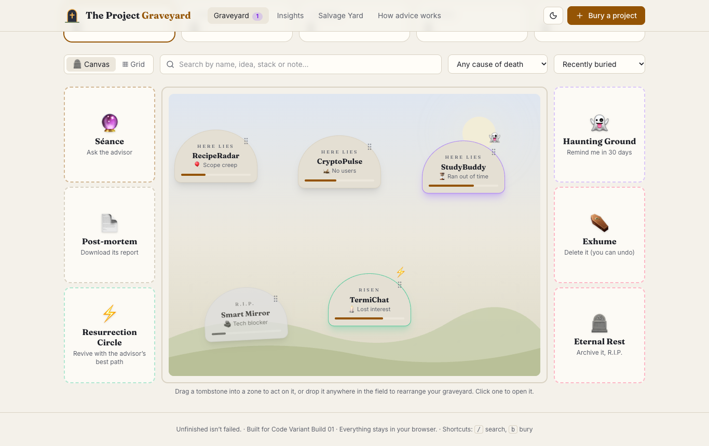
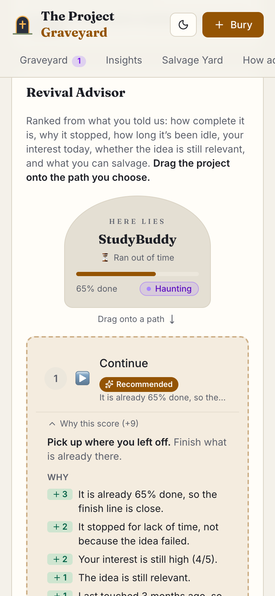

# The Project Graveyard

> Unfinished isn't failed.

A place to lay unfinished projects to rest, understand why they stopped, and decide whether they deserve a second life.
Built for **Code Variant · Build 01 · Problem Statement 05**.

**Live demo:** https://project-graveyard-codevariant.vercel.app



## 🎨 The Canvas Protocol (Variant Factor)

At hour 6 the rules changed: no standard buttons for primary actions. **Every primary action now happens by dragging a
data card into an action zone.** The product didn't change; the interaction did.

The home screen is now the **Graveyard Canvas**: tombstones stand in a night-time field. You rearrange them by
dragging them around, and you act on them by dragging them into the zones at its edges:
🔮 **Séance** (ask the advisor), ⚡ **Resurrection Circle** (revive with the advisor's best path), 🪦 **Eternal Rest**
(archive), 👻 **Haunting Ground**, 📄 **Post-mortem** and ⚰️ **Exhume**. Every drop plays a small effect (light for a
revival, dust for a burial, a ghost for a haunt), and every change can be undone.

| Action | Before | Now: drag… | …into |
| --- | --- | --- | --- |
| Bury a project | "Lay it to rest" button | the live **tombstone preview** | **The grave** (or *Update the tombstone* when editing) |
| Choose a revival path | "Choose X" + modal | the **project card** | one of the five **ranked path zones** (fit % and reasons stay visible) |
| Reconsider a decision | "Reconsider" button | the **decision card** | **Dig it back up** |
| Revive or archive in one move | (open project, choose path) | a **tombstone** on the canvas | **Resurrection Circle** / **Eternal Rest** |
| Haunt me later | button + modal | the project card or a **tombstone** | **Haunt me in 7 / 14 / 30 / 90 days**, or the **Haunting Ground** |
| Export post-mortem | button | the project card or a tombstone | **Export post-mortem** |
| Delete | button + confirm | the project card or a tombstone | **Exhume** (toast offers *Undo*) |
| Salvage a part | "Salvage it" button | the **new part card** | **the salvage bin**; drag a part to **Scrap** to remove it |
| Timeline entry | "Add" button | the **new entry card** | **the timeline**; drag an entry to **Erase** to remove it |
| Backup, reset, clear | buttons + confirm | the **graveyard card** | **Export JSON**, **Load demo**, **Empty** (with *Undo*) |
| Import a backup | file button | a **.json file** from your desktop, or the **file card** made by choosing one | **Import JSON** |

| Record a revisit | "Update advice" button | the **assessment card** (the pickers only preview the advice) | **Record revisit** or **Keep my old answers** |
| Remove a stack tag | × button | the **tag chip** | the **bin** |

Everything destructive can be undone from its toast. Typing needs no drag: next steps and epitaphs save as you type,
and GitHub import starts by itself when you paste a repo URL.

- **Mouse and touch:** pick up a card and drop it on a zone. Zones light up when they can take the card, and
  dropping on empty canvas does nothing.
- **Keyboard:** focus a card (or a tombstone's grip), press **Space**, use the **arrow keys** to jump between zones
  (off-screen zones scroll into view), then **Space** to drop or **Esc** to cancel. Picking a card up and putting it
  down without moving does nothing. A screen reader announces every step.
- **Built on** [`src/canvas/Canvas.tsx`](src/canvas/Canvas.tsx): one `DataCard`, one `ActionZone` and a provider
  (dnd-kit) that every screen reuses. Zero axe-core violations on every page in both themes.

## The problem

GitHub already keeps the code. What gets lost is the **context** (what was done, what was left, why it stopped) and the
**decision** (what is this project worth now?). Most builders only ever choose between "ignore it" and "delete it".
This is not a project-management app: no tasks, sprints or boards. It's a memory for every idea, plus an explained
decision about what happens next.

## What it does

| Feature | What it means |
| --- | --- |
| **Graveyard Canvas** | Every project as a tombstone in a field you arrange yourself, surrounded by action zones; or a Grid view with search, filters and sorting. Status shows at a glance (Resting · Haunting · Revived · R.I.P.). |
| **Bury a project** | A guided 3-step form (Tombstone → Autopsy → Assess) that autosaves, previews the advice, and finishes by dragging the tombstone into the grave. |
| **GitHub Import** | Paste a public repo URL to fill in the stack, the dates and a summary from the README. |
| **The Autopsy** | Tag why it stopped (time, scope creep, tech blocker, tech debt, lost interest, no users) and add a note. |
| **Revival Advisor** | Ranks Continue · Restart · Change the idea · Repurpose · Archive as drop zones, each showing its reasons for and against. Drag the project onto one to decide. |
| **Decide** | Revive with three next steps, or archive with an epitaph of lessons learned (both editable in place). Overriding the advisor is allowed and logged. |
| **Project Timeline** | Started → milestones → abandoned → revisited → decided, plus your own entries. |
| **Haunt Me Later** | Set a revisit reminder. Due projects switch to *Haunting* and show on the archive. |
| **Graveyard Insights** | Why your projects die, how far they get, what you decide, which stacks pile up, plain-language findings and an epitaph wall. |
| **Export post-mortem** | Download any project as a Markdown report (tombstone, autopsy, ranked advice with reasons, decision, timeline) to keep in its repo. |
| **Salvage Yard** | Reusable parts (code, lessons, assets) from every project, all in one place. |

<table>
  <tr>
    <td width="50%"><br /><sub>Revival Advisor: drag the project onto a path; every point is explained</sub></td>
    <td width="50%"><br /><sub>Project actions: haunt, export and exhume are drop zones</sub></td>
  </tr>
  <tr>
    <td><br /><sub>Bury: drag the live tombstone into the grave</sub></td>
    <td><br /><sub>Insights: patterns across the whole graveyard</sub></td>
  </tr>
  <tr>
    <td><br /><sub>How advice works: the rules, straight from config</sub></td>
    <td><br /><sub>The Graveyard Canvas in light mode</sub></td>
  </tr>
  <tr>
    <td colspan="2" align="center"><br /><sub>Touch drag and drop on phones</sub></td>
  </tr>
</table>

## How the Revival Advisor works

It is rule-based and transparent, with no black box.

1. Each project becomes six **signals**: completion %, cause of death, months idle, interest today (1–5), whether the
   idea is still relevant, and how many parts are salvageable.
2. Each **rule** checks one or more signals and adds or removes points from one path. Every rule carries the sentence
   the user sees, e.g. *"+3 It is already 65% done, so the finish line is close."*
3. The path with the highest score is **recommended**. Every path shows its reasons for and against, and a fit % on a
   scale shared by all paths, so the numbers always agree with the ranking.
4. The user makes the final call. Choosing a different path is allowed, and the timeline records it.

The in-app **How advice works** page renders every rule from the config.

## Config-driven

Causes, statuses, revival paths, next-step templates and every advisor rule live in
[`src/config/index.ts`](src/config/index.ts). Changing the app's behaviour means editing data, not screens.
See [`docs/CONFIG.md`](docs/CONFIG.md) for step-by-step recipes.

## Tech

React + Vite + TypeScript · Tailwind CSS v4 · dnd-kit (drag and drop) · Zustand (persisted to localStorage) · React Router · Framer Motion ·
GitHub REST API (public, no auth) · Vitest · Vercel. There is no backend: everything stays in the browser, with
JSON export/import for backups.

```
src/
  canvas/     DataCard, ActionZone and the drag-and-drop provider
  config/     causes, statuses, paths and advisor rules
  engine/     advisor.ts: pure scoring, plus tests
  store/      Zustand stores (projects, toasts)
  lib/        GitHub import, insights, seed data, helpers
  components/ Tombstone, Advisor, Timeline, Modal, Toaster…
  pages/      Archive, Bury, Project, Insights, Salvage Yard, How advice works
```

Accessibility: keyboard drag and drop with screen-reader announcements, shortcuts (`/` search, `b` bury), labelled controls, respects *reduce motion*,
light/dark themes, and zero axe-core violations on every page in both themes (WCAG AA contrast).

## Run it

```bash
npm install
npm run dev      # http://localhost:5173
npm test         # 31 tests: advisor, insights, import/export validation, GitHub parsing
npm run build
```

See [`docs/DEMO.md`](docs/DEMO.md) for a 3-minute demo script.

**Submission details:** [`docs/SUBMISSION.md`](docs/SUBMISSION.md) (links, descriptions, twist summary).

**Presentation:** final deck in [PDF](docs/Project_Graveyard_CodeVariant_PS05_Final.pdf) and [PowerPoint](docs/Project_Graveyard_CodeVariant_PS05_Final.pptx) (with speaker notes); the Round 1 idea deck is alongside it.
